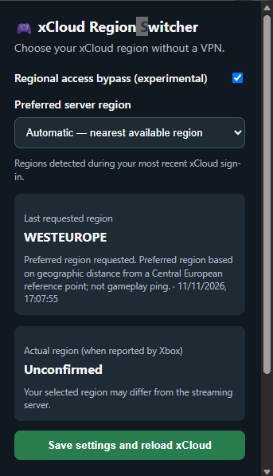
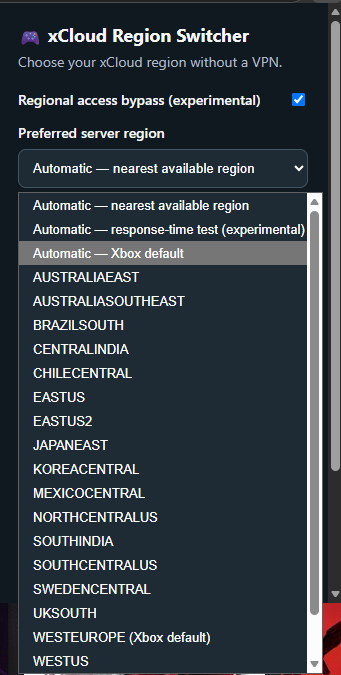

# xCloud Region Switcher

A lightweight, unofficial extension for Microsoft Edge and Google Chrome that lets you choose a preferred Xbox Cloud Gaming (xCloud) region without a built-in VPN or proxy.

## Features

- Experimental region bypass (does **not** change your public IP)
- Automatic selection of the nearest *known* region based on distance from a fixed Central European reference point
- Experimental HTTP response-time comparison, with automatic geographic fallback
- Manual selection from regions returned by xCloud
- Shows the requested region and, when explicitly reported by Xbox, the actual region
- Saves settings locally using browser extension storage

## Screenshots

### Extension Interface

The extension popup showing regional access bypass, automatic region selection, the last requested region, and the actual region status when available.

### Available Server Regions

The region selector lists the regions detected from Xbox Cloud Gaming, including automatic selection modes and the Xbox default region.

## Installation (unpacked extension)

1. Download and extract the ZIP archive.
2. Open `edge://extensions` or `chrome://extensions`.
3. Enable **Developer mode**.
4. Choose **Load unpacked** and select the extracted `xcloud-region-switcher` folder.
5. Visit `https://www.xbox.com/play` or `https://play.xbox.com`.
6. Choose your settings in the extension popup and click **Save settings and reload xCloud**.

## Limitations and compatibility

- This is an **unofficial**, experimental project and is not affiliated with Microsoft or Xbox.
- Regional availability and functionality are not guaranteed. Using the extension may be subject to Xbox terms and regional restrictions.
- The region requested by the extension may differ from the actual streaming server.
- The latency test measures HTTP response time to eligible endpoints provided by Xbox, **not** the streaming server's network ping. Browser restrictions may prevent tests.
- Automatic geographic selection uses a fixed Central European reference point; it is not a precise-location feature.
- No guarantee of lower latency, better performance, or support for future Xbox website updates.

## Privacy and permissions

The extension requests `storage` and access to Xbox pages to apply settings and inspect supported responses. It does not include a remote telemetry server or VPN. The experimental bypass attempts to set an `X-Forwarded-For` header in a login request; servers and browsers may ignore or block it. Review the source code before installing.

## License

MIT License. See [LICENSE](LICENSE).

## Contributing and feedback

Please open a GitHub issue with your browser version, xCloud URL, selected region, and steps to reproduce. Avoid sharing account tokens or private session data.

## Release

Version **1.5.1** — English UI. Tested by the project owner; behavior may vary by account, browser, and region.